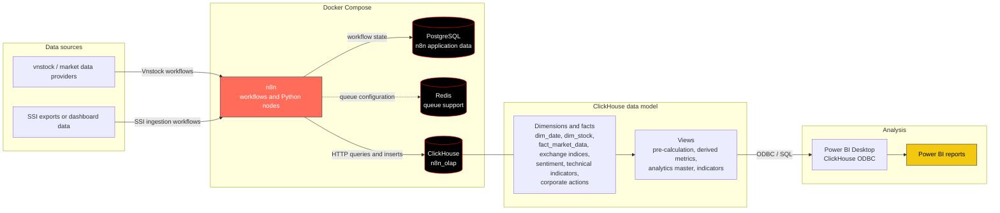

# Stock
This project automates Vietnamese stock-market data ingestion and analytics with n8n, Python, and ClickHouse. Docker Compose runs the workflow engine and its supporting services; Power BI Desktop connects to ClickHouse for analysis and visualization.

## Deployment (Docker)
To spin up n8n with the pre-configured Python environment:
```Bash
docker compose build --no-cache
docker compose up -d
```

## Architecture


### Component responsibilities

- **n8n** orchestrates ingestion, seed, technical-indicator, and maintenance workflows. The workflows are versioned in `n8n_workflows/`.
- **Python** runs in n8n's Python nodes for Vnstock-backed collection and processing; the custom image is based on `naskio/n8n-python` and installs dependencies from `requirements.txt`. It is not a separate Compose service.
- **PostgreSQL** stores n8n application data. **Redis** is configured for n8n queue support.
- **ClickHouse** is the analytical store. n8n sends queries and inserts to its HTTP endpoint on the Compose network; table and view DDL is maintained under `clickhouse_query/`.
- **Power BI Desktop** connects from the host through the ClickHouse ODBC driver. No Power BI Gateway service is defined in this Compose project.
- Compose persists PostgreSQL, Redis, and ClickHouse data in named volumes. The n8n state, local files, and optional Python scripts are mounted from `n8n_data/`, `local_files/`, and `python_scripts/`.

### Data flow

1. Scheduled or manually triggered n8n workflows collect data from Vnstock, SSI exports, or SSI dashboard payloads.
2. Workflow nodes normalize and de-duplicate records, then write them to ClickHouse over HTTP. Seed and maintenance workflows also update or purge data there.
3. ClickHouse views provide pre-calculated and derived data for technical analysis and reporting.
4. Power BI Desktop reads ClickHouse through ODBC to refresh reports and visualizations.

## Clickhouse Setup

### OLAP Tables Structure

#### Dimension Tables (Descriptive Data)
1. **dim_date (Calendar Dimension)**: A specialized calendar table that allows for time-series analysis across non-standard dimensions like trading vs. non-trading days, fiscal quarters, and day-of-week performance.
2. **dim_stock (Stock Profile)**: Stores company metadata. Use ReplacingMergeTree so that when n8n rescans the market, it updates existing records with the latest info.

#### Fact Tables
1. **fact_market_data (Market Price & Volume)**: The central repository for Daily OHLCV (Open, High, Low, Close, Volume) data. Physically sorted by symbol and trade_date to make calculating SMA, EMA, and CMF lightning-fast.
2. **fact_market_sentiment (Capital Flow)**: Tracks institutional and foreign movement to gauge market sentiment.
3. **fact_technical_indicators (Technical Indicators)**: Stores pre-calculated technical indicator values derived from historical price and volume data across standard timeframes.
4. **fact_exchange_index_histories (Exchange Index History)**: Stores historical index values, price changes, market breadth, and trading activity for Vietnam's HOSE, HNX, and UPCoM indices. The `ReplacingMergeTree` table is partitioned monthly by `time` and ordered by `(index_id, time)`. See [the exchange indices documentation](docs/exchange_indices.md) for the full column schema and covered indices; its DDL is in `clickhouse_query/create_table/create_fact_exchange_index_history.sql`.
5. **corporate_actions** and **fact_portfolio_return_metrics**: Store corporate-action records and portfolio-return metrics.

#### Pre-calculated and Analytics Views
1. **v_pre_calculate_market_data**: Provides pre-calculated price and volume values used by downstream calculations.
2. **v_derived_metrics**, **v_analytics_master_consolidated**, **v_indicators_base**, and **v_indicators_nor**: Provide derived metrics and analytical views for indicators and reporting.

### Create Tables
- Run the scripts inside `clickhouse_query/create_table`, `clickhouse_query/create_view`, and `clickhouse_query/create_analytics_layer` in dependency order.
- Add new columns to the schema using the migration script `clickhouse_query/utils/add_new_column.sql`.

### Import seed data
- Import seed data for `dim_stock` using `clickhouse_seed_data/stock_seed_data.csv`.

## n8n Setup 

### Local Development & Testing
Follow these steps to debug and test your scripts locally before deploying them to your workflow.

#### Virtual Environment
- Install Virtual Environment:
```Bash
python -m venv .venv
```
- Activate Virtual Environment:
```Bash
.venv\Scripts\activate
```

#### Install packages
```Bash
pip install -r requirements.txt
```

#### Test a Python node locally
Copy the Python node logic into a local script and replace n8n input references with representative test data. `test_bench.py` is a standalone example with sample items; it does not import code from an n8n workflow.

#### Run test
Run the local script (or the sample bench) to inspect its JSON output:
```Bash
python test_bench.py
```

### Import workflows
Import all workflows in folder `n8n_workflows`

### Preventing JSON Output Corruption in n8n Python Scripts

#### Handling n8n's Communication Logic
- Automation platforms like n8n expect a very specific JSON format as the final output of a script. If a library (like `vnstock`) prints any "Welcome" messages, logs, or progress bars to the console, it corrupts the JSON output, causing the n8n node to crash.
- Solution: Wraps the logic to ensure that only the final returned list of dictionaries is captured as the result.
- The Return Format: Returning {"json": {"symbol": sym}} matches exactly what n8n needs to process items in a workflow.

#### The SuppressOutput Context Manager
- This is the most critical part of the design. Many financial libraries print metadata or "Powered by..." messages upon being imported.
```Python
    class SuppressOutput:
        def __enter__(self):
            self._original_stdout = sys.stdout
            self._original_stderr = sys.stderr
            self._devnull = open(os.devnull, 'w', encoding='utf-8')
            sys.stdout = self._devnull
            sys.stderr = self._devnull
        def __exit__(self, exc_type, exc_val, exc_tb):
            sys.stdout = self._original_stdout
            sys.stderr = self._original_stderr
            self._devnull.close()

    with SuppressOutput():
        from vnstock import Listing
        listing = Listing()
        symbols_list = listing.symbols_by_group(input_group).to_list()
    
    return [{"json": {"symbol": sym}} for sym in symbols_list]
```
- `os.devnull`: This acts as a "black hole." By redirecting `sys.stdout` and `sys.stderr` here, any text printed by the vnstock library is discarded.
- Encapsulation: It ensures that "noise" from the library doesn't interfere with the "signal" (your data).
- Restoration: The `__exit__` method restores the original settings so that the final `print()` at the very bottom of the script actually works.

#### Character Encoding Strategy
```Python
sys.stdin.reconfigure(encoding='utf-8')
```
- Since you are dealing with Vietnamese stocks and potentially Vietnamese company names, standard ASCII encoding might fail.
- UTF-8 Safety: Reconfiguring the standard streams ensures that the script can handle Vietnamese characters without throwing UnicodeEncodeError.

#### Efficient Data Mapping
- The list comprehension `[{"json": {"symbol": sym}} for sym in symbols_list]` transforms a flat list of stock tickers into an array of objects.
- n8n Compatibility: This allows n8n to treat each stock symbol as an individual "item," enabling you to loop through them in subsequent nodes (like getting prices for each stock).

## Power BI

## Connect to Clickhouse

**Step 1: Config the Clickhouse Connection**
- ODBC Driver (outdated):
    1. Go to the ClickHouse ODBC Github Releases.
    2. Download the 64-bit MSI installer (e.g., clickhouse-odbc-1.1.10-win64.msi).
    3. Install it on the Windows machine where Power BI Desktop is located.
- Clickhouse Driver (currently used)

**Step 2: Configure the Windows DSN** - This step tells Windows exactly where your ClickHouse server lives.
1. Open ODBC Data Source Administrator (64-bit) on your PC.
2. Go to the *System DSN* tab and click *Add*.
3. Select *ClickHouse Unicode* and click *Finish*.
4. Fill in the configuration:
    - Name: `ClickHouse_Stock`
    - Host: `localhost` (if using Docker locally) or your Server IP.
    - Port: `8123` (Standard HTTP port for ClickHouse).
    - Database: `n8n_olap`.
    - User: `default` (unless you changed it).
5. Click *Test* to ensure it says "Success."

**Step 3: Connect Power BI to the DSN** - Now, open Power BI Desktop to pull the data.
- Using ODBC Driver: (ODBC Driver does not provide enough metadata information => can not use **Direct Query** option)
    1. Click *Get Data* > *More...* > Search for ODBC.
    2. In the Data source name (DSN) dropdown, select `ClickHouse_Stock`.
    3. Storage Mode (Critical Decision):
        - Import: Use this for `dim_stock` and `dim_date`. It loads the data into RAM for lightning-fast filtering.
        - DirectQuery: Use this for your `v_indicators_base` View. Power BI will send the SQL queries directly to ClickHouse so your PC doesn't have to calculate the SMA/RSI math.
    5. Select your tables and click Load.
- Using Clickhouse Driver (currently used):
    1. Click *Get Data* > *More...* > Search for ODBC.
    2. In the Data source name (DSN) dropdown, select `ClickHouse`.
    3. Storage Mode (Critical Decision):
        - Import: Use this for `dim_stock` and `dim_date`. It loads the data into RAM for lightning-fast filtering.
        - DirectQuery: Use this for your `v_indicators_base` View. Power BI will send the SQL queries directly to ClickHouse so your PC doesn't have to calculate the SMA/RSI math.
    5. Select your tables and click Load.

### Other configuration

**Disabling Column Aggregation (Set Summarization to “Do not summarize”)**
1. Change to *Table View*
2. Select a column (e.g. close, sma_20, ema_20)
3. Go to *Column tools* -> Find *Summarization* -> Choose *Do not summarize*

**Create Relationship Between Dim Tables and Fact Tables - Which Clikhouse does not have**
1. Change to *Model View*
2. On menu, click *Manage relationships*

### Core Visualizations & Layout
1. **Technical Trend Analysis (The Main Chart)**:
    - Visual: Line and Column Chart or a specialized Candlestick custom visual.
    - X-axis: `trade_date`
    - Y-axis: `close`, `ema`, `sma`, `rsi`, `cmf`, `volume`...
2. **Filter Analysis**: Use Slicer to analyse which stock should be buy 

## Workflows

### Seed data
1. **dim_stock**: Import data from `clickhouse_seed_data\stock_seed_data.csv` to clickhouse
2. **dim_date**: Run n8n workflow `n8n_workflows\Stock__Seed_Dim_Date.json`
3. **fact_stock_prices**: Run n8n workflwo `n8n_workflows\Stock__Seed_Price_Data.json`

### Mine Stock data

#### Vnstock as Data source (Deprecated)
1. Run workflow in n8n: `n8n_workflows\Stock__Mine_Market_Data_Vnstock.json`
2. If there is error, re-run the workflow with option `Retry with curently saved workflow (from node with error)`

- Primary Use Case: Historical data backfilling and backup source.
- Technical Constraint: Rate-limited to 60 requests per minute.

#### SSI as Data source
1. Download market data *csv files from SSI
2. Run workflow in n8n: `n8n_workflows\Stock___Mine_Market_Data_SSI_csv.json`

or

1. Open browser's console while being in SSI dashboard page, copy javascript code inside `scripts\ssi_data_puller.js` 
2. Run workflow in n8n: `n8n_workflows\Stock___Mine_Market_Data_SSI_json.json`, `n8n_workflows\Stock___Mine_Corporate_Actions_SSI_json.json` and  `n8n_workflows\Stock___Mine_Exchange_Indices_Data_SSI_json.json`

- Primary Use Case: Daily real-time data extraction.
- Technical Constraint: Restricted to current-day data only, requiring immediate daily processing for high throughput.

### Visualize data
1. Open one of the Power BI reports in `power_bi_visual/`.
2. At tab `Home` -> group `Queries` -> `Refresh`

### Optimize Investment
1. **Analyze and Select Assets (`SelectedSymbols`)**:
Review technical and financial analysis to select a target pool of potential stocks. Enter the chosen tickers into the `SelectedSymbols` parameter, separated by commas (e.g., `HPG, FPT, SSI`).
2. **Configure Input Parameters**:
* **`SelectedTradeDate`**: Set the base trading date to retrieve historical data and expected metrics.
* **`TotalInvestment`**: Input the total capital budget planned for execution (e.g., `100000000`).
3. **Execute the Script**:
Open Power Query Editor, select the query, and click **Refresh Preview** (or **Apply & Close**) to trigger the Python Sharpe ratio optimization model.
4. **Interpret Output Metrics**:
* **`optimal_weight`**: Target capital allocation percentage for each asset (sums to 1.0).
* **`allocated_amount`**: Precise capital amount to spend on each stock ($\text{optimal\_weight} \times \text{TotalInvestment}$).
* **`suggested_shares`**: Recommended number of shares to purchase ($\lfloor \text{allocated\_amount} / \text{close\_price} \rfloor$).

### Purge Cold data
1. Run workflow in n8n `n8n_workflows\Stock__Purge_Data.json`
2. Check data in `dim_date` and `fact_stock_prices` tables