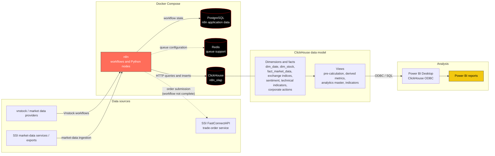
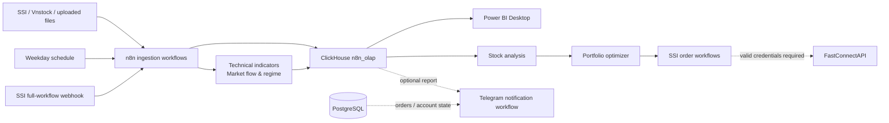

# Stock
This project automates Vietnamese stock-market data ingestion and analytics with n8n, Python, and ClickHouse. Docker Compose runs the workflow engine and its supporting services; Power BI Desktop connects to ClickHouse for analysis and visualization.

## Deployment (Docker)
To spin up n8n with the pre-configured Python environment:
```Bash
docker compose build --no-cache
docker compose up -d
```
The n8n container is configured with a 3072 MB Node.js heap limit; make sure Docker has sufficient memory available.

## Architecture


### Component responsibilities

- **n8n** orchestrates ingestion, seed, technical-indicator, market-flow, market-regime, portfolio, and maintenance workflows. The workflow exports are versioned in `n8n_workflows/`.
- **Telegram notifications** are optional through `Stock___Notification.json`; the workflow sends reports for ClickHouse and PostgreSQL data but is not required for trading or analytics.
- **SSI / FastConnectAPI** has two separate roles: SSI supplies market data, corporate actions, exchange indices, and account APIs, while FastConnectAPI provides the brokerage order APIs. The project includes an active equity order workflow and a separate FCO order workflow. Both can submit real orders, so valid credentials and careful request validation are required.
- **Python** runs in n8n's Python nodes for Vnstock-backed collection and processing; the custom image is based on `naskio/n8n-python` and installs dependencies from `requirements.txt`. It is not a separate Compose service.
- **PostgreSQL** stores n8n application data. **Redis** is configured for n8n queue support.
- **ClickHouse** is the analytical store. n8n sends queries and inserts to its HTTP endpoint on the Compose network; table and view DDL is maintained under `clickhouse_query/`.
- **Power BI Desktop** connects from the host through the ClickHouse ODBC driver. No Power BI Gateway service is defined in this Compose project.
- Compose persists PostgreSQL, Redis, and ClickHouse data in named volumes. The n8n state, local files, and optional Python scripts are mounted from `n8n_data/`, `local_files/`, and `python_scripts/`.

### Data flow



The SSI full workflow runs on a weekday schedule or through its production webhook. It ingests market data, corporate actions and exchange indices, then calculates analytical indicators and stores results in ClickHouse. Analysis data is used by Power BI and the portfolio/order strategy. The optional Notification workflow sends market overview, watchlist and order-book reports to Telegram; it does not affect ingestion or order execution. Order submission requires valid SSI credentials.

## Clickhouse Setup

### OLAP Tables Structure

#### Dimension Tables (Descriptive Data)
1. **dim_date (Calendar Dimension)**: A specialized calendar table that allows for time-series analysis across non-standard dimensions like trading vs. non-trading days, fiscal quarters, and day-of-week performance.
2. **dim_stock (Stock Profile)**: Stores company metadata. Use ReplacingMergeTree so that when n8n rescans the market, it updates existing records with the latest info.

#### Fact Tables
1. **fact_market_data (Market Price & Volume)**: The central repository for Daily OHLCV (Open, High, Low, Close, Volume) data. Physically sorted by symbol and trade_date to make calculating SMA, EMA, and CMF lightning-fast.
2. **fact_market_sentiment (Capital Flow)**: Tracks institutional and foreign movement to gauge market sentiment.
3. **fact_technical_indicators (Technical Indicators)**: Stores pre-calculated technical indicator values derived from historical price and volume data across standard timeframes.
4. **fact_exchange_index_histories (Exchange Index History)**: Stores historical index values, price changes, market breadth, and trading activity for Vietnam's HOSE, HNX, and UPCoM indices. The `ReplacingMergeTree` table is partitioned monthly by `time` and ordered by `(index_id, time)`. See [the exchange indices documentation](docs/exchange_indices.md) for the full column schema and covered indices; its DDL is in `clickhouse_query/create_table/create_fact_exchange_index_history.sql`.
5. **corporate_actions** and **fact_portfolio_return_metrics**: Store corporate-action records and portfolio-return metrics.

#### Pre-calculated and Analytics Views
1. **v_pre_calculate_market_data**: Provides pre-calculated price and volume values used by downstream calculations.
2. **v_derived_metrics**, **v_analytics_master_consolidated**, **v_indicators_base**, and **v_indicators_nor**: Provide derived metrics and analytical views for indicators and reporting.

### Create Tables
- Run the scripts inside `clickhouse_query/create_table`, `clickhouse_query/create_view`, and `clickhouse_query/create_analytics_layer` in dependency order.
- Add new columns to the schema using the migration script `clickhouse_query/utils/add_new_column.sql`.

### Import seed data
- Import seed data for `dim_stock` using `clickhouse_seed_data/stock_seed_data.csv`.

## n8n Setup 

### Local Development & Testing
Follow these steps to debug and test your scripts locally before deploying them to your workflow.

#### Virtual Environment
- Install Virtual Environment:
```Bash
python -m venv .venv
```
- Activate Virtual Environment:
```Bash
.venv\Scripts\activate
```

#### Install packages
```Bash
pip install -r requirements.txt
```

#### Test a Python node locally
Copy the Python node logic into a local script and replace n8n input references with representative test data. `test_bench.py` is a standalone example with sample items; it does not import code from an n8n workflow.

#### Run test
Run the local script (or the sample bench) to inspect its JSON output:
```Bash
python test_bench.py
```

### Import workflows
Import the workflow JSON files from `n8n_workflows/` into n8n. n8n workflow IDs used by `Execute Workflow` nodes are local to an instance, so update sub-workflow references after import if n8n assigns different IDs.

The exports currently expose the following active state:

| Workflow export | Active in export | Entry point / trigger |
|---|---:|---|
| `Stock___SSI_full_workflow.json` | Yes | Schedule on weekdays at 12:00 and `POST /webhook/ssi-full-workflow` |
| `Stock___Mine_Market_Data_SSI_json.json` | Yes | `POST /webhook/mine-market-data-ssi-json` |
| `Stock___Mine_Market_Data_SSI_csv.json` | Yes | `POST /webhook/mine-market-data-ssi` |
| `Stock___Mine_Corporate_Actions_SSI_json.json` | Yes | `POST /webhook/mine-corporate-actions-ssi-json` |
| `Stock___Mine_Corporate_Actions_SSI_xlsx.json` | Yes | `POST /webhook/mine-corporate-actions-ssi` |
| `Stock___Mine_Exchange_Indices_Data_SSI_json.json` | Yes | `POST /webhook/mine-exchange-indices-data-ssi-json` |
| `Stock___Seed_Dim_Date.json` | Yes | Monthly cron on the first day at 12:00 and `POST /webhook/seed-dim-date` |
| `Stock___Track_Technical_Indicators.json` | Yes | `POST /webhook/track-technical-indicators` |
| `Stock___Track_Market_Flow_Indicators.json` | Yes | `POST /webhook/track-market-flow-indicators` |
| `Stock___Optimize_Buy_Strategy.json` | Yes | `POST /webhook/optimize-buy-strategy` |
| `Stock___SSI_Auth.json` | No | `POST /webhook/ssi-auth` |
| `Stock___SSI_Track_Account_Balance.json` | Yes | `POST /webhook/ssi-track-account-balance` |
| `Stock___SSI_Trade_Orders.json` | Yes | `POST /webhook/ssi-trade-order`; weekday schedule at 01:15 |
| `Stock___SSI_Trade_Orders_FCO.json` | Yes | `POST /webhook/ssi-trade-order` |
| `Stock___SSI_Registry_Order_Book.json` | Yes | `POST /webhook/ssi-registry-order-book` |
| `Stock___Notification.json` | Yes | `POST /webhook/notification`; optional weekday schedule at 14:00 |
| `Stock___Track_Market_Flow_Classification.json` | No | `POST /webhook/track-market-flow-classification` |
| `Stock___Mine_Market_Data_Vnstock.json` | No | Legacy/manual execution |
| `Stock___Seed_Price_Data.json` | No | Legacy/manual execution |
| `Stock___Purge_Data.json` | No | Manual execution |

### Preventing JSON Output Corruption in n8n Python Scripts

#### Handling n8n's Communication Logic
- Automation platforms like n8n expect a very specific JSON format as the final output of a script. If a library (like `vnstock`) prints any "Welcome" messages, logs, or progress bars to the console, it corrupts the JSON output, causing the n8n node to crash.
- Solution: Wraps the logic to ensure that only the final returned list of dictionaries is captured as the result.
- The Return Format: Returning {"json": {"symbol": sym}} matches exactly what n8n needs to process items in a workflow.

#### The SuppressOutput Context Manager
- This is the most critical part of the design. Many financial libraries print metadata or "Powered by..." messages upon being imported.
```Python
    class SuppressOutput:
        def __enter__(self):
            self._original_stdout = sys.stdout
            self._original_stderr = sys.stderr
            self._devnull = open(os.devnull, 'w', encoding='utf-8')
            sys.stdout = self._devnull
            sys.stderr = self._devnull
        def __exit__(self, exc_type, exc_val, exc_tb):
            sys.stdout = self._original_stdout
            sys.stderr = self._original_stderr
            self._devnull.close()

    with SuppressOutput():
        from vnstock import Listing
        listing = Listing()
        symbols_list = listing.symbols_by_group(input_group).to_list()
    
    return [{"json": {"symbol": sym}} for sym in symbols_list]
```
- `os.devnull`: This acts as a "black hole." By redirecting `sys.stdout` and `sys.stderr` here, any text printed by the vnstock library is discarded.
- Encapsulation: It ensures that "noise" from the library doesn't interfere with the "signal" (your data).
- Restoration: The `__exit__` method restores the original settings so that the final `print()` at the very bottom of the script actually works.

#### Character Encoding Strategy
```Python
sys.stdin.reconfigure(encoding='utf-8')
```
- Since you are dealing with Vietnamese stocks and potentially Vietnamese company names, standard ASCII encoding might fail.
- UTF-8 Safety: Reconfiguring the standard streams ensures that the script can handle Vietnamese characters without throwing UnicodeEncodeError.

#### Efficient Data Mapping
- The list comprehension `[{"json": {"symbol": sym}} for sym in symbols_list]` transforms a flat list of stock tickers into an array of objects.
- n8n Compatibility: This allows n8n to treat each stock symbol as an individual "item," enabling you to loop through them in subsequent nodes (like getting prices for each stock).

## Power BI

## Connect to Clickhouse

**Step 1: Config the Clickhouse Connection**
- ODBC Driver (outdated):
    1. Go to the ClickHouse ODBC Github Releases.
    2. Download the 64-bit MSI installer (e.g., clickhouse-odbc-1.1.10-win64.msi).
    3. Install it on the Windows machine where Power BI Desktop is located.
- Clickhouse Driver (currently used)

**Step 2: Configure the Windows DSN** - This step tells Windows exactly where your ClickHouse server lives.
1. Open ODBC Data Source Administrator (64-bit) on your PC.
2. Go to the *System DSN* tab and click *Add*.
3. Select *ClickHouse Unicode* and click *Finish*.
4. Fill in the configuration:
    - Name: `ClickHouse_Stock`
    - Host: `localhost` (if using Docker locally) or your Server IP.
    - Port: `8123` (Standard HTTP port for ClickHouse).
    - Database: `n8n_olap`.
    - User: `default` (unless you changed it).
5. Click *Test* to ensure it says "Success."

**Step 3: Connect Power BI to the DSN** - Now, open Power BI Desktop to pull the data.
- Using ODBC Driver: (ODBC Driver does not provide enough metadata information => can not use **Direct Query** option)
    1. Click *Get Data* > *More...* > Search for ODBC.
    2. In the Data source name (DSN) dropdown, select `ClickHouse_Stock`.
    3. Storage Mode (Critical Decision):
        - Import: Use this for `dim_stock` and `dim_date`. It loads the data into RAM for lightning-fast filtering.
        - DirectQuery: Use this for your `v_indicators_base` View. Power BI will send the SQL queries directly to ClickHouse so your PC doesn't have to calculate the SMA/RSI math.
    5. Select your tables and click Load.
- Using Clickhouse Driver (currently used):
    1. Click *Get Data* > *More...* > Search for ODBC.
    2. In the Data source name (DSN) dropdown, select `ClickHouse`.
    3. Storage Mode (Critical Decision):
        - Import: Use this for `dim_stock` and `dim_date`. It loads the data into RAM for lightning-fast filtering.
        - DirectQuery: Use this for your `v_indicators_base` View. Power BI will send the SQL queries directly to ClickHouse so your PC doesn't have to calculate the SMA/RSI math.
    5. Select your tables and click Load.

### Other configuration

**Disabling Column Aggregation (Set Summarization to “Do not summarize”)**
1. Change to *Table View*
2. Select a column (e.g. close, sma_20, ema_20)
3. Go to *Column tools* -> Find *Summarization* -> Choose *Do not summarize*

**Create Relationship Between Dim Tables and Fact Tables - Which Clikhouse does not have**
1. Change to *Model View*
2. On menu, click *Manage relationships*

### Core Visualizations & Layout
1. **Technical Trend Analysis (The Main Chart)**:
    - Visual: Line and Column Chart or a specialized Candlestick custom visual.
    - X-axis: `trade_date`
    - Y-axis: `close`, `ema`, `sma`, `rsi`, `cmf`, `volume`...
2. **Filter Analysis**: Use Slicer to analyse which stock should be buy 

## SSI Configuration

SSI (SSI Securities Corporation) is a Vietnamese joint-stock securities company. In this project it has two distinct roles: SSI market-data services are a source for snapshots, exchange indices, and corporate-action data; SSI's FastConnectAPI is the intended brokerage interface for submitting trade orders. n8n coordinates these integrations, while ClickHouse stores data for analytics and reporting. SSI and FastConnectAPI are external services, not Docker services or databases in this stack.

### FastConnectAPI trade-order workflow

The equity workflow `n8n_workflows/Stock___SSI_Trade_Orders.json` formats submitted orders, adds a batch request ID and timestamp, signs the request, and calls SSI's batch stock-order endpoint. Its export is active and exposes `POST /webhook/ssi-trade-order`; it also has a weekday schedule at 01:15.

A separate `n8n_workflows/Stock___SSI_Trade_Orders_FCO.json` export also uses `POST /webhook/ssi-trade-order` and submits to SSI's FCO order endpoint. It is active in the export and must not be enabled alongside the equity workflow when both produce the same local webhook path.

Both order workflows can submit real orders. Configure valid SSI credentials and verify the payload, account number, side, quantity, price, and market-specific rules before activation.

### Configure SSI environment variables

Docker Compose passes these four variables to the n8n container:

```env
SSI_API_KEY=your_ssi_api_key
SSI_API_SECRET=your_ssi_api_secret
SSI_ACCOUNT_NO=your_ssi_account_number
SSI_PRIVATE_KEY=your_ssi_private_key
```

`SSI_PRIVATE_KEY` accepts the PEM private key or the Base64-encoded RSA XML key provided by SSI. Put the values in the project-root `.env` file alongside `docker-compose.yml`. The Compose defaults (`ssiapikey`, `ssiapisecret`, `ssiaccountno`, and `ssiprivatekey`) are placeholders, not usable credentials. After changing the `.env` file, recreate n8n so the container receives the new values:

```bash
docker compose up -d --force-recreate n8n
```

Keep real credentials private; `.env` is ignored by Git and must not be committed.

## Optional Telegram Notifications

The `Stock___Notification.json` workflow is optional. It sends a stock report containing market indices, market regime and allocation, the default-analyser watchlist, recorded orders, and the corporate-actions calendar.

It has both entry points:

- `POST /webhook/notification` for an on-demand report.
- A weekday schedule at 14:00 in n8n's configured timezone.

Configure the Telegram chat ID in the project-root `.env` file:

```env
TELEGRAM_BOT_CHAT_ID=your_personal_or_group_chat_id
```

Docker Compose passes this value to n8n as `TELEGRAM_BOT_CHAT_ID`. Create a Telegram credential in n8n with the bot access token from `@BotFather`, then keep or replace the workflow's **Telegram account** credential reference.

The workflow also reads ClickHouse and PostgreSQL data. Recreate n8n after changing `.env`:

```bash
docker compose up -d --force-recreate n8n
```

For bot creation, `/getUpdates`, chat-ID lookup, credential setup and testing, see [Set Up Telegram Notifications](docs/setup_telegram_notification_bot.md).

## Workflows

### Seed data
1. **dim_stock**: Import data from `clickhouse_seed_data\stock_seed_data.csv` to clickhouse
2. **dim_date**: 
    - The n8n workflow `n8n_workflows/Stock___Seed_Dim_Date.json` has a monthly schedule on the first day of each month at 12:00, using n8n's configured timezone (`GENERIC_TIMEZONE`; Docker Compose defaults to UTC). Ensure the workflow is active in n8n for the schedule to run. Each scheduled run inserts dates from the first day of the current month through the last day of the following two months, then optimizes the table to remove duplicate rows. 
    - For initial setup or a custom range, send `POST /webhook/seed-dim-date` with `start_date` and `end_date` as `YYYY-MM-DD` form-data fields; if either field is omitted, the workflow uses its default range.
    - `dim_date.is_trading_day` currently marks weekdays as trading days and weekends as non-trading days; it does not account for Vietnamese market holidays.
3. **fact_market_data**: Legacy seed workflow `n8n_workflows/Stock___Seed_Price_Data.json` writes to `fact_stock_prices`; prefer the active SSI JSON/CSV ingestion workflows for current data.

### Mine Stock data

#### Vnstock as Data source (Deprecated)
1. Run workflow in n8n: `n8n_workflows\Stock___Mine_Market_Data_Vnstock.json`
2. If there is error, re-run the workflow with option `Retry with curently saved workflow (from node with error)`

- Primary Use Case: Historical data backfilling and backup source.
- Technical Constraint: Rate-limited to 60 requests per minute.

#### SSI as Data source
1. Download market data *csv files from SSI
2. Run workflow in n8n: `n8n_workflows\Stock___Mine_Market_Data_SSI_csv.json`

For an integrated SSI ingestion and analysis run, import [Stock___SSI_full_workflow.json](n8n_workflows/Stock___SSI_full_workflow.json) into n8n. The exported workflow is active. It has two entry points:

1. **Schedule:** it starts on weekdays at 12:00 in n8n's configured timezone. Its embedded SSI data-puller gathers a current snapshot, then the workflow invokes the corporate-actions, market-data, and exchange-index subworkflows. It then calculates technical indicators and market-flow indicators, tracks market regime, runs the default analyzer, and invokes the SSI registry/order-book workflow.
2. **Webhook:** send a `POST` to the workflow's `ssi-full-workflow` webhook path. An uploaded binary file under the `file` field takes the ingestion path. Without that field, the workflow uses `trade_date` from the request body or defaults to the current date, then runs the default analyzer path. The webhook response is sent after the response node is reached.

The standalone JavaScript collectors below are useful when you only need the SSI snapshot or want to reuse collection code; the full workflow already has its own embedded SSI data-puller node.

##### Browser collector
Use `scripts/ssi_data_puller_browser.js` when you want to download a JSON snapshot manually:
1. Open the SSI iBoard dashboard in a browser and open its developer console.
2. Paste and run the script. It requests exchange-index data for VNINDEX, VN30, HNX30, VNXALL, HNXIndex, and HNXUpcomIndex, plus the VN30 group and HOSE, HNX, and UPCoM main-board stock lists.
3. The script merges stock records by `stockSymbol` and downloads `stock_master_data_YYYYMMDD.json`. The JSON contains `exchangeIndicesData` and `marketData`, each with `code`, `totalRecords`, and `data` fields. See [the sample output](scripts/samples/stock_master_data_sample.json).

##### n8n Code node collector
Use `scripts/ssi_data_puller_node.js` by pasting its contents into an n8n Code node when you want a standalone collector. It makes SSI index and stock-list requests using n8n's `this.helpers.httpRequest`, first requesting the SSI portal to obtain cookies. It returns an n8n item with a JSON summary (`status`, record counts, and `fileName`) and a binary property named `data` containing the complete JSON file. It does not download a file to the local machine. The filename is `stock_master_data_YYYYMMDD.json`. To send this binary to the full workflow's webhook ingestion path, rename/map the binary property from `data` to the expected `file` field.

Both standalone collectors use the current SSI responses when run; the date in the filename is the run date, not a historical-data selector. The browser version logs request errors and may omit a failed data section from the downloaded JSON. The n8n version can return partial results when individual requests fail. Neither standalone script collects corporate actions; the integrated workflow above includes a corporate-actions branch.

- Primary Use Case: Daily real-time data extraction.
- Technical Constraint: Restricted to current-day data only, requiring immediate daily processing for high throughput.

### Track market flow and market regime

- `Stock___Track_Market_Flow_Indicators.json` is active in the export and accepts `start_date` and `end_date` query parameters at `POST /webhook/track-market-flow-indicators`. When omitted, both default to the current date.
- `Stock___Track_Market_Flow_Classification.json` exposes `POST /webhook/track-market-flow-classification` with the same optional date parameters, but its export is inactive. Activate it after confirming the `fact_market_regime_histories` schema includes all allocation and override columns.
- `Stock___Track_Technical_Indicators.json` is active and exposes `POST /webhook/track-technical-indicators`.

### SSI account and order-book workflows

- `Stock___SSI_Auth.json` provides SSI OTP/token authentication as a subworkflow and is inactive in the export.
- `Stock___SSI_Track_Account_Balance.json` exposes `POST /webhook/ssi-track-account-balance` and is active in the export.
- `Stock___SSI_Registry_Order_Book.json` exposes `POST /webhook/ssi-registry-order-book`, invokes SSI authentication, retrieves account balance and target allocation, calculates a buy strategy, and can invoke the stock-order workflow.

### Visualize data
1. Open one of the Power BI reports in `power_bi_visual/`.
2. At tab `Home` -> group `Queries` -> `Refresh`

### Optimize Investment
Portfolio allocation is available through Power BI's Power Query M query or the n8n webhook. Both use `fact_portfolio_return_metrics` in ClickHouse and optimize allocations against expected returns and volatility. The M query is used in Power BI Desktop; n8n uses its separate workflow and Python code.

#### Power BI (Power Query M)
Use [optimize_portfolio_return_value_m_query.m](optimize_portfolio_return_value_scripts/optimize_portfolio_return_value_m_query.m) as the shared M query in Power BI Desktop's Power Query Editor. Configure these Power Query parameters:

- **`SelectedSymbols`**: Comma-separated tickers (for example, `HPG, FPT, SSI`).
- **`SelectedTradeDate`**: The latest date to include.
- **`TotalInvestment`**: The total budget (for example, `100000000`).

Refresh the query in Power BI's Power Query Editor. The query filters roughly 90 calendar days of source data and uses up to 60 recent trading dates for optimization.

#### n8n webhook
Import [Stock___Optimize_Buy_Strategy.json](n8n_workflows/Stock___Optimize_Buy_Strategy.json). The exported workflow is active. For a test run, click **Test workflow** and send a `POST` to `http://localhost:5678/webhook-test/optimize-buy-strategy`. After activating the workflow, use `http://localhost:5678/webhook/optimize-buy-strategy`.

The JSON request body uses `selected_symbols` as an array:

```json
{
  "total_investment": 100000000,
  "selected_trade_date": "YYYY-MM-DD",
  "selected_symbols": ["HPG", "FPT", "SSI"]
}
```

The matching request template is [Optimze Buy Strategy.request.yaml](web_hook/Stock/Optimze%20Buy%20Strategy.request.yaml). The workflow queries ClickHouse and passes the results to the Python optimizer in [optimize_portfolio_return_value_n8n_python.py](optimize_portfolio_return_value_scripts/optimize_portfolio_return_value_n8n_python.py). The Docker image installs its `scipy` dependency from `requirements.txt`; rebuild it after dependency changes.

#### Results
The optimizer returns `calculated_for_date`, `symbol`, `close_price`, `expected_return`, `optimal_weight`, `allocated_amount`, and `suggested_shares`. `optimal_weight` values sum to 1, and `allocated_amount` is the weight multiplied by `TotalInvestment`. `suggested_shares` is currently the allocation divided by close price and may be fractional; apply the exchange's lot-size and order rules before using it as an order quantity. These outputs are estimates, not trade orders.

### Purge Cold data
1. Run workflow in n8n `n8n_workflows\Stock___Purge_Data.json`
2. Check data in `dim_date` and `fact_market_data`/legacy `fact_stock_prices` tables as applicable